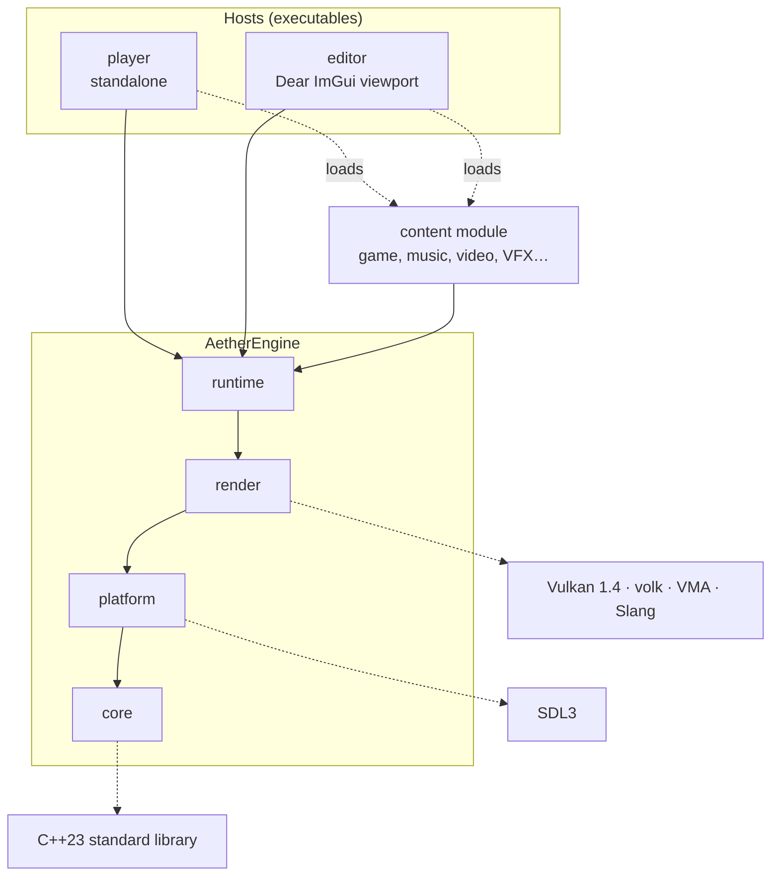

# Architecture

How the engine is split, how a project plugs into it, and how it is linked.
Decisions and their rationale are recorded in the
[global plan](https://github.com/AIperture-Labs/.github/blob/main/PLAN.md).



The same diagram is editable in [architecture.drawio](architecture.drawio).

## Modules

Each module depends only on the modules below it, never the other way.

| Module | Depends on | Content |
| --- | --- | --- |
| `core` | the C++23 standard library | Base types, logger, assertions, errors with `std::expected`, memory |
| `platform` | `core`, SDL3 | The only module talking to the OS: window, events, input, files, time, shared-library loading, Vulkan surface |
| `render` | `core`, `platform`, Vulkan (volk, VMA) | Instance and device, swapchain, pipelines, frame synchronization, deferred deletion, Slang shaders |
| `runtime` | `core`, `platform`, `render` | The main loop and the content lifecycle, shared by the hosts: starts the engine, loads and checks the content, runs it, shuts everything down |

## Hosts and content

A project (a game, a demo, a piece of music, a video, a VFX sequence…) builds
one content module: it implements `IContent` and declares it with
`AETHER_CONTENT`. Hosts stay thin: they read their arguments and
hand the content to `runtime`.

- `player` runs it standalone, full screen.
- `editor` runs it inside its viewport.

`render` always draws to an offscreen image, then presents it to the window
(`player`) or shows it in an ImGui panel (`editor`).

The entry point:

```cpp
// <aether/runtime/content.hpp>
namespace aether::runtime {

class IContent {
public:
    virtual ~IContent() = default;

    [[nodiscard]]
    virtual Status init(Runtime &runtime) = 0;
    [[nodiscard]]
    virtual Status update(f32 deltaSeconds) = 0;
};

struct ContentDescriptor {
    const char *engineVersion;  // core::kVersionString of the content's build
    const void *coreIdentity;   // core::identity(), as the content sees it
    core::EBuildProfile buildProfile;  // core::kBuildProfile of that build
    const char *name;
    IContent *(*create)();
};

}  // namespace aether::runtime

// In one source file of the content; defines
// extern "C" const ContentDescriptor *aetherContent();
AETHER_CONTENT(MyProject)
```

`runtime` reads the descriptor, creates the content, calls `init`, then
`update` every frame, and destroys it before the renderer and the platform
shut down; in dynamic mode, before its library is unloaded. An error returned
by `init` or `update` is logged and stops the host cleanly, with a non-zero
exit code; `Runtime::requestQuit()` ends the loop normally.

Before its destructor returns, the content has removed everything it
registered in the engine (log sinks, callbacks) and stopped its threads:
nothing in the engine may point into the content once it is destroyed, since
its library is then unloaded.

### The context

`Runtime` is the engine context. `runtime` creates one, which owns the
subsystems (the window, the renderer, and later audio, assets…), and hands it
to the content in `init`; the content reaches every subsystem through it, and
it grows with what content needs. Engine modules above `core` keep their
state in such objects, never in globals: the creation and shutdown order is
explicit, and a test creates its own instance.

Only the services that any code must reach without being handed anything are
global, in `core`: the logger and the assertion handler (later the allocator
and the profiler).

Content reads time only from the `deltaSeconds` that `runtime` passes, never
from the clock: a real-time host passes the elapsed time, a later offline
host (exporting a video or an audio file) a fixed step, and the content runs
the same in both.

Project types (game, music, video, VFX…) are templates chosen at project
creation, with the editor: they pick the plugins and the exports (an
executable, a video or audio file…), not a different kind of content.

## Build modes

The engine is built in one of two modes, set by `BUILD_SHARED_LIBS` (the
preset):

| Mode | Presets | Engine modules | Content | Used for |
| --- | --- | --- | --- | --- |
| Dynamic | `*-shared` | Shared libraries | Shared library, loaded by the host at run time | Development, the editor, later hot reload |
| Monolithic | The others | Static libraries | Static library, linked into one executable | Shipping |

In dynamic mode, the generic `player` takes the content library's path on its
command line. In monolithic mode, `aether_add_module(<name> CONTENT …)` also
builds an executable `<name>`: the player's `main` linked with the content,
calling `aetherContent()` directly.

### One copy of each engine state

Each global state (the logger and its sinks, and the internal state of SDL
and volk) exists once in the process. A second copy would work silently on its
own: content logging through its own copy of `core` never reaches the host's
sinks. Hence:

- Engine modules and content always share one mode: the CMake API cannot
  build a static engine with dynamically loaded content.
- A third-party library with global state is linked into exactly one engine
  module (SDL3 into `platform`, volk and VMA into `render`); content and the
  other modules reach it through that module, never by linking it.
- Global state is defined in a source file of its module and reached through
  an exported function, never in a header: symbols are hidden by default, so
  an `inline` variable, or a `static` local of an `inline` function, would
  exist once per shared library.
- The C and C++ runtimes are dynamic in both triplets
  (`VCPKG_CRT_LINKAGE dynamic`): one heap, so memory allocated on one side of
  a library boundary can be freed on the other.
- Executables and shared libraries are built into the same `bin/`
  directory, so each library is found, and loaded, once.

### Load checks

Before creating the content, `runtime` refuses it, with a `Fatal` log and a
non-zero exit code, when:

- `engineVersion` differs from its own `core::versionString()`: the content
  was built against another engine, and the C++ interface is not stable
  across versions;
- `coreIdentity` differs from its own `core::identity()`: the content carries
  its own copy of `core`;
- `buildProfile` differs from its own `core::kBuildProfile`: assertions and
  log macros would be compiled differently on each side.

In monolithic mode the three checks pass by construction.

## Module descriptor

There is no descriptor file yet: a module's name, kind and dependencies are
the arguments of `aether_add_module()`, and the content's name is in its
`ContentDescriptor`. A TOML descriptor comes when a tool must read modules
without building them: the editor and project creation.

## Plugins

Plugins follow the same modes and rules. Several plugins can be linked into
one monolithic executable, so each entry point carries the plugin's name
(`aetherPlugin_<name>`) where content has the single `aetherContent`; the
registration details are settled with the first plugin, and module APIs
accept validation layers in both modes.
