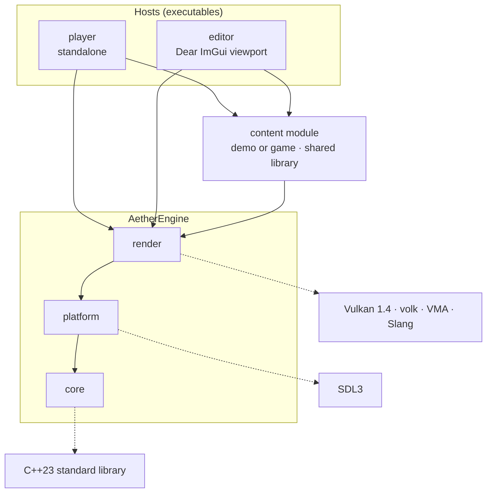

# Architecture

How the engine is split, and who depends on whom. Decisions and their
rationale are recorded in the
[global plan](https://github.com/AIperture-Labs/.github/blob/main/PLAN.md).

The same diagram is editable in [architecture.drawio](architecture.drawio).

## Modules

Each module depends only on the modules below it, never the other way.

| Module | Depends on | Content |
| --- | --- | --- |
| `core` | the C++23 standard library | Base types, logger, assertions, errors with `std::expected`, memory |
| `platform` | `core`, SDL3 | The only module talking to the OS: window, events, input, files, time, shared-library loading, Vulkan surface |
| `render` | `core`, `platform`, Vulkan (volk, VMA) | Instance and device, swapchain, pipelines, frame synchronization, deferred deletion, Slang shaders |

## Hosts and content

A demo or a game is a content module: a shared library with a standard entry
point. Two hosts load it:

- `player` runs it standalone, full screen.
- `editor` runs it inside its viewport.

`render` always draws to an offscreen image, then presents it to the window
(`player`) or shows it in an ImGui panel (`editor`).

## Linking

Engine modules are static by default and can be built shared with a CMake
option. Plugins and content modules are shared by default, for hot reload,
and can be linked statically into a monolithic shipping build.
